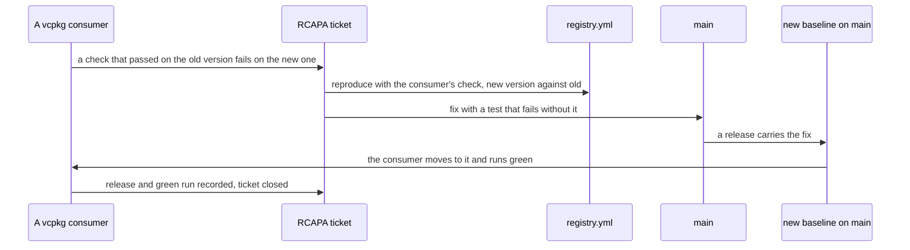

# RCAPA: regressions in a release of swarm-routing/vcpkg-registry

An **RCAPA** (root cause analysis with corrective and preventive actions) is
the full record of one **regression in a published library**: a version of
it that another project consumes (a release pinned by a lock, PyPI, a vcpkg
port) worked, and a later one broke. A bug or change that never reached a
published version needs none (an ordinary `bug` issue is enough), a Docker
image needs one only when its composition is the cause, and an upstream
ns-3 bug is an `NS3-NNN` in swarm-routing/ns3-tools. The org's rule and its decision table are in
[CONTRIBUTING.md, "RCAPA"](https://github.com/swarm-routing/.github/blob/main/CONTRIBUTING.md#rcapa)
([ADR-0003](https://github.com/swarm-routing/.github/blob/main/docs/adr/0003-rcapa-for-ns3-bugs-and-released-regressions.md)).
This page is the project's flow and its index.

## The flow for this project

Consumers pin this registry by a **baseline** commit, and each port names a
library release. A regression here is a port **recipe** that worked at one
baseline and broke at a later one: the port stops installing, installs
something different from its release asset, or installs but breaks a
consumer of the installed package (its CMake package no longer found by
`find_package`). A defect of the library itself is an RCAPA in that library's
repository (`SWC-NNN` in swarm-routing/ns3-swarm-core, a protocol's prefix
for its core). A recipe defect fixed before it reached `main` needs none.

| | |
|---|---|
| Published as | port recipes in `ports/` and the `versions/` database, at the baseline commit a consumer pins |
| ID prefix | `VCP-NNN` |
| Ticket | an issue in swarm-routing/vcpkg-registry, form *Regression in a release (RCAPA)*, title `[rcapa] VCP-NNN <short description>`, labels `rcapa` and `bug`; name the port, its version and both baselines |
| Verified by | the consumer's own failing check (install, configure or build), run outside the registry's CI against both baselines; then the registry's own checks, `registry.yml` (tools self-test, `tools/port_bump.py check`, install on `x64-linux` and `wasm32-emscripten`, the `find_package` consumer in `test/consumer/`, `x-ci-verify-versions`) |
| Corrective action | the fix PR with a new `port-version`, never a rewritten version: `tools/port_bump.py refresh` when the upstream description changed, `bump` for a new release; for a portfile-only fix, by hand: `port-version` raised in `ports/<port>/vcpkg.json`, a new entry with the port's git-tree in `versions/<c>-/<port>.json`, `versions/baseline.json` updated, then `tools/port_bump.py check` |
| Preventive action | a check in `port_bump.py` or a consumer case in `test/consumer/` |
| Closes when | the fix is merged to `main` (the new baseline commit recorded) **and** the consumer's check that failed passes at that baseline |

## Index

| ID | RCAPA | RCAPA ticket | Fixed in |
|----|-------|--------------|----------|

## Adding one: the ticket first

1. Open the RCAPA ticket (the table above). `NNN` is the next free number in
   the index.
2. Copy [`_template.md`](_template.md) to `rcapa-<short-description>.md`
   (lowercase, hyphens: what breaks, not where it was found), and add its row
   to the index in the same pull request.
3. The ticket stays open until the fix is merged to `main` and the consumer's check that failed passes at the new baseline; record that baseline commit in the index.

## What an RCAPA answers

1. **What broke, in which release, and who did it touch?** The symptom, the
   releases that fail and the last that passes, the users, numbers or
   downstream pins it affects.
2. **How do I see it myself?** Exact commands, the release or commit, an
   image by tag and digest when one is involved, seeds, expected against
   actual.
3. **Why did it happen, and why did our checks let it into a release?** Five
   whys, each citing its evidence: a source line at a named commit, a log, a
   run, a comment. An answer without a source is a hypothesis and says so.
4. **What does it look like?** Mermaid diagrams: the failing call chain, the
   types or components involved.
5. **What did we do about it?** Corrective actions (the fix, its PR, the
   release that carries it) and preventive actions (the test or check that
   catches a recurrence). An action not done yet is an open issue, linked.
6. **When?** A dated timeline and every link.

## Writing one

- Every issue and PR reference is fully qualified: `swarm-routing/<repo>#N`,
  also for this repository's own items; an ns-3 item is a link whose text is
  `nsnam/ns-3-dev#N` to its full gitlab.com URL. Never a bare number with a
  hash. In a mermaid block, which cannot hold a hash, name the item in words.
- Mermaid: no HTML entities inside a block; write template arguments as
  words.
- An RCAPA is never deleted. Later findings update its status and timeline.
